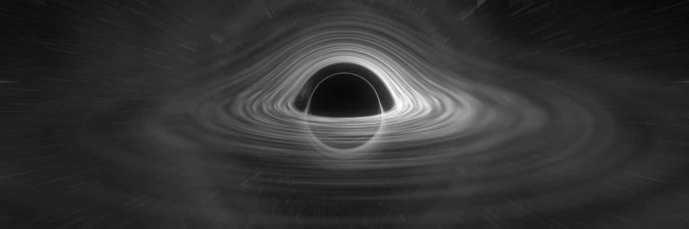

  

<h1 align="center">Hi, I'm Arctica 👋</h1>

  High school developer building software in <b>cybersecurity</b> and <b>open data</b>. 
  Into computer science, physics and engineering. 
  Long-term: AI research, or a company of my own.

  The banner isn't a picture I found — it's computed. Every pixel is a light ray integrated through
  Schwarzschild spacetime (<code>d²u/dφ² = −u + 3u²</code>), bent around the hole, Doppler-shifted by the disk's rotation.
  <a href="banner/blackhole.mjs">Source, ~400 lines of dependency-free JS.</a>

  

---

## 🔭 What I'm building

  

  

How the Reforestation map scores a cell

  

  

---

## 🧭 Roadmap

  

### Milestone 1 — learning how LLMs work by building one

  

  A tiny GPT written from scratch in dependency-free JavaScript, with backpropagation done by hand and checked against numerical gradients. Everything in the picture is real data from the trained model.
  The strips at the bottom are the point: it is 98% sure of every character of a quote it has seen 75 times, and 34% sure on a sentence it has never seen. That gap is memorising versus learning.
  <a href="llm/README.md">Code and numbers.</a>

---

## 📈 Activity

  

