  

<h1 align="center">Hi, I'm Arctica 👋</h1>

  High school developer building software in <b>cybersecurity</b> and <b>open data</b>. 
  Into computer science, physics and engineering. 
  Long-term: AI research, or a company of my own.

  The banner isn't a picture I found — it's computed. Every pixel is a light ray integrated through
  Schwarzschild spacetime (<code>d²u/dφ² = −u + 3u²</code>), bent around the hole, Doppler-shifted by the disk's rotation.
  <a href="banner/blackhole.mjs">Source, ~400 lines of dependency-free JS.</a>

  

---

## 🔭 What I'm building

### Unchained — OSINT & attack-surface reconnaissance
Enter a domain or a Discord ID. Unchained detects what it is and queries every matching source in parallel.

- **Plugin architecture** — every source runs as its own Node process with a timeout and an output limit
- **Live sources** — WHOIS/DNS, Certificate Transparency (crt.sh), Discord
- **Relationship graph** — interactive, with a custom layout (no graph library)
- **Cases & accounts** — scrypt password hashing, TOTP two-factor auth, CSRF protection
- Early-stage prototype, ~25k lines. Not publicly launched yet.

### Reforestation Planning Map
A map for nonprofits and volunteers that finds and ranks U.S. Forest Service land needing replanting after wildfires and hurricanes, using public federal and satellite data.

- **Pipeline** — Google Earth Engine + PostGIS score 30 m cells on six factors (burn severity, canopy loss, time since event, seed-source distance, slope, roads), then group them into planting zones
- **App** — FastAPI backend, React + MapLibre frontend with filters and score breakdowns
- **So far** — 851 zones (~72,000 acres) in Plumas National Forest, CA, plus 6 small zones from Hurricane Helene in Sumter National Forest, SC
- Working prototype; the scoring weights are heuristics I haven't validated yet.

  

---

## 🧠 Learning how LLMs work by building one

  

  A real, tiny GPT — 28k parameters, 2 layers, 4 heads — written from scratch in dependency-free JavaScript, with backpropagation done by hand and checked against numerical gradients.
  Every frame is a real forward pass: the arcs are its attention weights, the bars are its probabilities for the next character.
  It types a sentence of mine from memory: it has seen that line 75 times in training, which is exactly what small models do. On text it has never seen it mostly babbles.
  The point is the mechanism big models use. <a href="llm/README.md">Code and numbers.</a>

---

## 🕸️ Map of my work

  

  Rebuilt every week by <a href=".github/workflows/update-graph.yml">a GitHub Action</a> from my public repos — languages, topics, stars.
  Dashed means "not public yet". <a href="banner/repo-graph.mjs">Source.</a>

---

## 🌍 A bit more

- 🗣️ Speak Ukrainian, Russian and English; learning Japanese
- 🏊 Swimming and running when I'm away from the keyboard
- 🌱 Always happy to hear feedback on what I'm building
